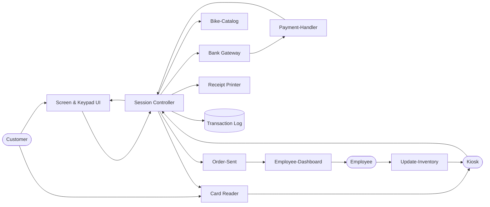

# Design Doc 

## Overview 
Rodney's Bike Shop system allows clients to reserve a bike(s) as well the client should be able to pay for it online. The staff should be able to list bikes for reservation, set prices, and put bikes into maintence as needed. 

## Actors 
* **Customer**: Place Order, Insert Payment, Take receipt 
* **Employee**: Check logs, Cancel-Orders, Update-Bookings, Excute Refunds, Remove Bikes, Add Bikes
* **Kiosk**: Take-Payment, Give-Change, Provide Receipt, Scroll, Add to Cart, Remove Bike
* **Online Website** Take-payment, provide receipt, scroll, add to cart, remove bike

## Goals/Non-Goals 

### Goals
* No account needed 
* Log all orders
* Alert staff automically 
* Print receipt 
* Charge correct prices  

### Non-Goals 
* No automatic discounts for now.
* Selling bikes is a diffrent system 
* No current inventory system, it's on paper
* No auto system for overbooking, from damage and late rental returns. 
* No auto system for stock limitatiosn 
* No system preventing rentals based on crazy weather clients could rent if they want  
* Replacement charge is human intervaention not auto
* Ad system handled by other team

## Constraints and Assumptions

### Constraints 
* There are 60 bikes, so about 60 rentals per day is the peak. This is not a high-concurrency system
* Rentals are capped at 7 days, in 4-hour intervals, and a day's fee equals 12 hours
* The card is pre-authorized at reservation and charged after return. Pre-authorization, charges, and refunds all use the processor's API. 
* Role base permissons for ownerm manager, employee
* All bike pickups, returns, extensions, size swaps, and damage assessments go through an employee during business hours. There is no self-service or after-hours pickup.

### Assumptions
* A bike out of service will be avaiable the next day, so let it be rented out for anyday after the day of service
* Most returned bikes are ready to be rented again after 4 hours, allow customers to book 4 hours after the expected return time.
* Card failure are caught 
* Everyone will use the dollar so no need for conversion rates/software/management 
* Abuse like mass no show reservations is low enough risk so don't design against it

## Non-Functional Requirements

| Requirement | Measure |
|---|---|
| Printed Receipt  | 100% of the time under 5 seconds |
| Order Sent  | Staff recieve order for bike from kiosk under 10 seconds |
| Payment Confirmation | 95% of the time payment confirmation is confirmed in under 9.99 seconds |
| System Restart | If system needs restart, system returns to normal state under 3 minutes |
| Wrong Payment Info | 0 Instances where wrong payment info is able to place a order |

## Component Diagram and Description

| Component | Responsibility |
|---|---|
|Receipt Printer  | Prints receipts  |
| Card Reader | Read card data |
| Kisosk | Terminal where customers can pick the bike and rent it for the day, as well pay |
| Session Controller | high level software ran on the kisok to provide information about the machine and the functionally needed from other componets |
| Bank Gateway | Connects the users information to the payment processor's API|
| Transaction Log| Contains logs all of transactions occuring on the terminal|
| Employee Dashboard | Pulls the order from session controller and lets employee see into the order|
| Screen & keypad UI | Allows customer to input pin and select the bike of their choosing|
| Update Inventory | Pulls from the employee dashboard and informs the kisok of any new changes made to the website or stock of bikes for rent|

