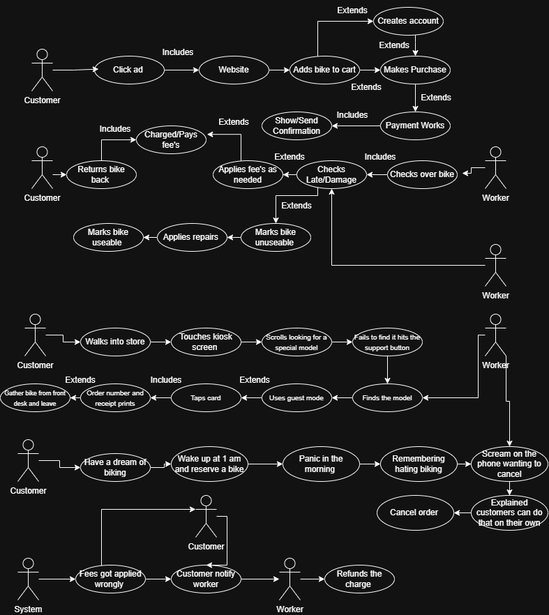

# Functional Spec : Rodney Ridealot'

## Highlevel Goal 
Rodney's Bike Shop system  allows clients to reserve a bike(s) as well the client should be able to pay for it online. The staff should be able to list bikes for reservation, set prices, and put bikes into maintence as needed. 

## User Scenarios
1. Zero to 100 : Barry Allen a lonely chap has been caught up in his my space doomscrolling phase again. In this fury of scrolling up and down the site on the side an ad flicks up. Mentioning "Tired of seeing two wheels on the screen and not underneath your two come rent a pair of wheels"! Without missing a beat he clicks the page delivering  him to Rodeney's site. A colorful vibrant site with models of bikes, prices, and bikes available to rent. Barry a hasty man clicks on the EXTREME MOUNTAIN SLAYER and NEEDS it in his life. He HATES signing up for everything. So when Barry selects the day he wants it. And adds the bike to cart. If the next is a forced sign up page without letting the user quick checkout with paypal or put his credit card information in and only give a phone number. CONSIDER that SALE like a sail in the wind GONE.  

2. Gas Light  : Robert Greene a everyday resident of Bend. Part time highly decorated writer. Famous for his novel the *48 Rules Of Power* has picked up a new gig, working for Rodney Ridealot's he's loving it. Mentions to his follow co-workers he never wants to leave. Adores the perks especially being able to rent bikes for free whenever! He feels so powerful controlling the flow of bikes leaving the shop. Yet for some reason his power of the system seems to be burning out. The oil that once keep the flame alive has faded into the lantern rescinding the once glorious flame. As everytime Robert scans the barcode on the bike to check it back in. The website says checked in with a green check across the screen. Yet when he refreshes the site it marks it as still not checked in. And the customer keeps getting text saying the bike hasn't been checked in. If Robert can't access tech support on the employee site.  Robert won't be living his dream anymore. He can't decide when a customer is checked back in with a bike. Breaking his rule over the bikes and customers. And will force him to resign. A system needs to be in place where if a website issue occurs. Rodney's Bike shop developer team can be notify and fix it ASAP! 

3. Free Guy : Ryan R has appeared into town this summer morning in a sulking mood. He has a bank heist planned for 11:30am. And for some reason. His phone couldn't get connected to the internet to reserve a time for a bike. This is really causing a jam for him. He has come to terms it is not the bike shops fault he has no service. Yet, if Ryan can not quickly access the kisok in the store. And rent a bike in 3 mintues he's going to do actions only someone expressing free will might consider. So we need to make sure the user who can't use their own device can use the instore kisok as soon as possible and as fast as possible to book transactions smoothly. As to secure that business.

4. Running out of Time : Nicolas C rented out a bike this morning, he wanted to take a couple bikes on a stroll. Mentioning something about trying to get the declaration of independence. Whatever that means? Well this trip seems to be taking longer then he rented out the bikes for. Likely overestimating how fast a bike moves and how far the declaration of independence was from Bend Oregon. A honest mistake. Well now he's getting text from the automated system, giving him the one hour warning and the thirty minute warning. As someone who likes to avoid late fees. He has called the shop, asking about renting the bike longer. Of course that would be great! Making even more money, so the system needs to have a way to quickly searched for any bikes about to be late. Then from that list click the bike(s) the user is talking about and show if someone has it reserve right after. If not the staff should have a button on that screen to quickly increase the rental time to the clients asking period. Keep Nicolas C happy and on his way to steal something.

## Non-Goals 
* No automatic discounts for now.
* Selling bikes is a diffrent system 
* No current inventory system, it's on paper
* No auto system for overbooking, from damage and late rental returns. 
* No auto system for stock limitatiosn 
* No system preventing rentals based on crazy weather clients could rent if they want  
* Replacement charge is human intervaention not auto
* Ad system handled by other team

## Use Case Diagram 
