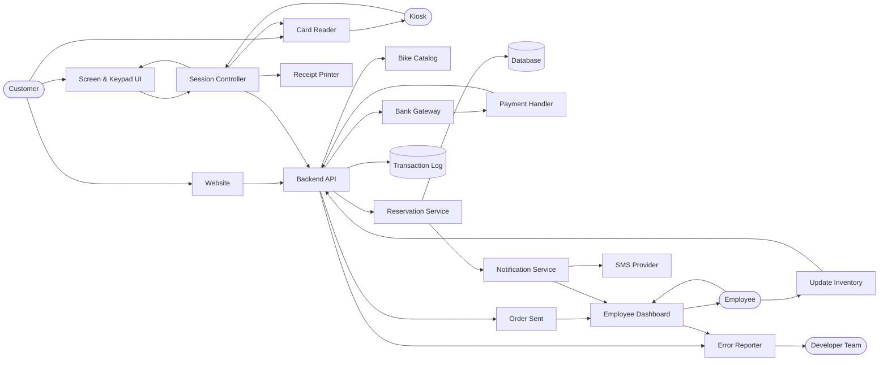

# Design Doc

## Overview
Rodney's Bike Shop system allows clients to reserve one or more bikes and pay for them online or at an in-store kiosk. Staff can list bikes for reservation, set prices, put bikes into maintenance, check bikes in and out, extend rentals, and report system problems to the developer team.

The system has three clients on one backend:
- **Website** (customers, guest checkout)
- **Kiosk** (in-store customers, same booking flow in a locked-down browser)
- **Employee site** (dashboard, check-in/out, extensions, admin)

## Actors
* **Customer**: Place Order, Insert Payment, Take receipt
* **Employee**: Check logs, Cancel Orders, Update Bookings, Execute Refunds, Remove Bikes, Add Bikes, Check bikes in/out, Extend rentals, Report issue
* **Manager / Owner**: Employee abilities plus set prices, approve replacement charges, manage staff roles (see Roles)
* **Kiosk**: Take Payment, Give Change, Provide Receipt, Scroll, Add to Cart, Remove Bike
* **Online Website**: Take payment, provide receipt, scroll, add to cart, remove bike
* **Notification Service** (system): Sends SMS, alerts staff, alerts developers

## Goals/Non-Goals

### Goals
* No account needed (guest checkout with card or PayPal; a phone number is the only required contact detail)
* Log all orders
* Alert staff automatically (new orders, rentals nearing end, system errors)
* Print receipt
* Charge correct prices
* Kiosk booking completes in about 3 minutes or less
* Check-in/out state is always correct and visible after refresh
* Developers are notified automatically of system faults, and staff can report problems from the employee site

### Non-Goals
* No automatic discounts for now.
* Selling bikes is a different system
* No current inventory system, it's on paper
* No auto system for overbooking, from damage and late rental returns.
* No auto system for stock limitations
* No system preventing rentals based on crazy weather; clients can rent if they want
* Replacement charge is human intervention, not auto
* Ad system handled by other team

## Constraints and Assumptions

### Constraints
* There are 60 bikes, so about 60 rentals per day is the peak. This is not a high-concurrency system (one app server plus one relational DB is sufficient).
* Rentals are capped at 7 days, in 4-hour intervals, and a day's fee equals 12 hours
* The card is pre-authorized at reservation and charged after return. Pre-authorization, charges, and refunds all use the processor's API.
* Role-based permissions for owner, manager, employee
* All bike pickups, returns, extensions, size swaps, and damage assessments go through an employee during business hours. There is no self-service or after-hours pickup.
* All money is USD, stored as integer cents. All times are stored in UTC and displayed in the shop's local time zone (Bend, OR).

### Assumptions
* A bike out of service will be available the next day, so it can be rented out for any day after the day of service
* Most returned bikes are ready to be rented again after 4 hours, so allow customers to book 4 hours after the expected return time (the "turnaround buffer").
* Card failures are caught (a failed pre-auth never creates a confirmed reservation)
* Everyone will use the dollar so no need for conversion rates/software/management
* Abuse like mass no-show reservations is low enough risk so don't design against it
* Pricing: each bike has a day rate set by staff. A rental is billed in 4-hour blocks, where 3 blocks (12 hours) equal one day fee. Block price = day rate / 3, rounded to the cent, and the total is capped at 7 days.
* Customers are reachable by SMS; email is optional.
* PayPal is offered on the website. The kiosk takes cards through the card reader.

## Non-Functional Requirements

| Requirement | Measure |
|---|---|
| Printed Receipt | 100% of the time under 5 seconds |
| Order Sent | Staff receive order for bike from kiosk under 10 seconds |
| Payment Confirmation | 95% of the time payment confirmation is confirmed in under 9.99 seconds |
| System Restart | If system needs restart, system returns to normal state under 3 minutes |
| Wrong Payment Info | 0 instances where wrong payment info is able to place an order |
| Check-in Consistency | 100% of check-ins shown as successful are persisted (verified by read-back) |
| Developer Alert | Developers notified under 1 minute of a server error or failed check-in write |
| Kiosk Booking | Median under 3 minutes from first touch to printed receipt |
| Late List Load | Ending-soon/late list loads under 2 seconds |

## Component Diagram and Description

| Component | Responsibility |
|---|---|
| Receipt Printer | Prints receipts |
| Card Reader | Read card data |
| Kiosk | Terminal where customers can pick the bike and rent it for the day, as well as pay |
| Session Controller | High-level software run on the kiosk. Drives the booking flow, talks to the Backend API, the card reader and the printer, and holds only in-memory session state |
| Website | Public customer site: bike list, bike detail, cart, guest checkout, card/PayPal payment, confirmation |
| Backend API | Single service exposing REST endpoints to the website, kiosk and employee site. Validates input, enforces roles, calls the other components |
| Bike Catalog | Bike records, models, sizes, day rates, status (available, maintenance, removed) |
| Reservation Service | Availability checks, pricing, reservation lifecycle, extensions, check-in/out. The only writer of reservation state |
| Bank Gateway | Connects the user's information to the payment processor's API |
| Payment Handler | Pre-authorization, capture, void, refund; stores processor references only (never card numbers) |
| Transaction Log | Append-only log of all orders, payment events, staff actions and status changes |
| Order Sent | Pushes new/changed orders to the Employee Dashboard (SSE/WebSocket, with polling fallback) |
| Employee Dashboard | Shows new orders, today's pickups and returns, the ending-soon/late list, and the check-in/out and extend actions. Includes a "Report Issue" button |
| Update Inventory | Staff add/remove bikes, set prices, set maintenance. Changes reach website and kiosk because all read the same Bike Catalog |
| Notification Service | Sends SMS to customers (confirmation, 1-hour and 30-minute warnings, late notice) and alerts to staff and developers |
| Error Reporter | Captures backend and frontend errors, tags them with context, and alerts developers |

## Data Model

| Table | Key fields |
|---|---|
| bike | id, barcode (unique), name, model, size, day_rate_cents, status (`AVAILABLE`, `MAINTENANCE`, `REMOVED`) |
| maintenance_window | id, bike_id, start_date, end_date (bike unavailable on these days only) |
| reservation | id, public_code, customer_phone, customer_email (optional), start_at, end_at, status, total_cents, version, created_via (`WEB`, `KIOSK`) |
| reservation_bike | reservation_id, bike_id, blocked_range (`[start_at, end_at + 4h)`) |
| payment | id, reservation_id, processor (`CARD`, `PAYPAL`), processor_ref, status, auth_cents, captured_cents, refunded_cents, idempotency_key |
| notification | id, reservation_id, type, scheduled_at, sent_at, status |
| audit_log | id, actor (user or system), action, entity, before, after, at |
| issue_report | id, reporter_id, reservation_id (optional), description, page, created_at, status |
| staff_user | id, name, role (`OWNER`, `MANAGER`, `EMPLOYEE`) |

* Double booking is prevented by the database: a unique/exclusion constraint on `(bike_id, blocked_range)` rejects overlapping ranges, so two simultaneous checkouts cannot both succeed.
* `reservation.version` is used for optimistic concurrency on every state change.

## Reservation Lifecycle

`CART` (not stored) → `RESERVED` (pre-auth succeeded) → `ACTIVE` (employee hands over bike) → `RETURNED` (employee scans barcode at check-in) → `CLOSED` (payment captured)

Side exits: `CANCELLED` (before pickup; auth voided or refunded), `LATE` (flag on `ACTIVE` once `end_at` has passed).

* A reservation is created only after the pre-authorization succeeds. A declined card never reserves bikes.
* A temporary hold on the selected bikes lasts 10 minutes while the customer pays. The hold expires automatically.
* The customer chooses a start and a duration in 4-hour blocks (up to 7 days). Total is calculated on the server and never trusted from the client.
* Bike availability for a time range requires: bike status is not `REMOVED`, no maintenance window overlaps (a bike in service on day D is bookable from D+1), and no other reservation's blocked range overlaps (expected return + 4h buffer).
* After check-in, the payment is captured for the final amount (including any late time at the day rate). Replacement or damage charges are manual: a manager enters them and the system captures an additional amount.

## Key Flows

### Guest checkout (website)
1. Customer picks a bike and date/time, then adds it to the cart.
2. Guest Checkout page asks for phone number only (email optional) and offers PayPal or card. No account is created or required.
3. Server re-checks availability and price, then creates the pre-authorization with an idempotency key.
4. On success: create reservation, log the order, send the confirmation SMS with a link to the receipt page, notify the dashboard.
5. On failure: show the processor's error, keep the cart, create no reservation.

### Kiosk booking (in-store)
1. Touch screen goes straight to the bike list with only available bikes shown, showing price and size.
2. Select bike, date/time and duration, then enter phone number on the keypad, then tap/insert card.
3. Session Controller calls the Backend API, shows "Processing", and prints the receipt on confirmation. The order appears on the Employee Dashboard.
4. The session resets after 60 seconds of inactivity. No card data is kept on the kiosk.
5. If the backend or the card reader is unreachable, the kiosk shows an "out of order, please see staff" screen and alerts staff and developers. It never accepts a partially processed order.

### Pickup, check-in and extension (employee)
* **Pickup:** Employee finds the reservation (by phone number or code), scans the bike barcode, and the reservation becomes `ACTIVE`.
* **Check-in:** Employee scans the bike barcode and the API does the following in one transaction:
  1. Looks up the active reservation for that bike.
  2. Sets `RETURNED` (idempotent: scanning twice returns the same result, not an error).
  3. Writes the audit log and cancels pending warning SMS.
  4. Triggers payment capture.
* The UI shows the green check **only after** the API returns the committed state, then re-fetches the reservation. If the re-fetched state doesn't match, the UI shows an error and a failure alert is sent to the developers.
* **Ending-soon/late list:** The dashboard has a list, sorted by `end_at`, of all `ACTIVE` reservations ending within the next 2 hours or already late. Selecting one shows the bikes, the customer phone number, and whether any bike has a reservation starting before the new end (plus buffer).
* **Extend:** A button on that screen lets the employee choose extra time in 4-hour blocks, up to the 7-day cap. If no conflicting reservation exists (including the buffer), the API updates `end_at`, increases the pre-authorization (or adds an incremental one), logs the change, and reschedules the warning SMS. If there is a conflict, the button is disabled and the conflicting reservation is shown.

## Notifications
* Customer SMS: confirmation, 1-hour warning, 30-minute warning, late notice.
* The warnings are rows in `notification` scheduled from `end_at` and are re-created on extension.
* A worker checks for due notifications every minute. **Before sending, it re-reads the reservation status**, so a bike that has been checked in never triggers a warning. Failed sends are retried 3 times, then logged and shown to staff.
* Staff alerts (new order, bike late, extension request) appear live on the Employee Dashboard.

## Error Reporting and Support
* Backend and frontend (website, kiosk, employee site) errors are sent to the Error Reporter with the user role, page, reservation id and request id. Developers are alerted on every new error type and when the error rate rises.
* Check-in/out writes that fail, time out, or fail read-back verification raise a high-priority alert.
* The employee site has a **Report Issue** button on every page. It creates an `issue_report` (prefilled with the current page and reservation) and notifies developers immediately. It is available to all roles and is always visible, even when other actions are failing.
* Health check endpoint plus a heartbeat from each kiosk. If a kiosk misses heartbeats for 2 minutes, staff and developers are alerted.
* Request ids are returned to the user on failure so that staff can quote them to developers.

## Roles and Permissions

| Action | Employee | Manager | Owner |
|---|---|---|---|
| View bikes, orders, logs | ✓ | ✓ | ✓ |
| Check bikes in/out, extend, update bookings | ✓ | ✓ | ✓ |
| Cancel orders, execute refunds | ✓ | ✓ | ✓ |
| Add/remove bikes, set maintenance | ✓ | ✓ | ✓ |
| Set bike prices | | ✓ | ✓ |
| Approve replacement/damage charges | | ✓ | ✓ |
| Manage staff users and roles | | | ✓ |

Employee login is required for all staff actions. Customers never log in.

## API Summary (REST, JSON)

| Endpoint | Purpose |
|---|---|
| `GET /bikes?start=&end=` | Available bikes and prices for a range |
| `POST /reservations` | Create reservation and pre-authorization (guest; idempotency key header required) |
| `GET /reservations/{code}` | Receipt/confirmation (public by unguessable code) |
| `POST /reservations/{id}/pickup` | Staff: mark `ACTIVE` |
| `POST /checkins` (`bike barcode`) | Staff: check in (idempotent) |
| `GET /reservations/ending-soon` | Staff: ending-soon and late list |
| `POST /reservations/{id}/extend` | Staff: extend by N blocks |
| `POST /reservations/{id}/cancel`, `POST /payments/{id}/refund` | Staff |
| `POST /bikes`, `PATCH /bikes/{id}`, `POST /bikes/{id}/maintenance` | Staff inventory and prices |
| `POST /issues` | Report an issue |
| `GET /events` | SSE stream for dashboard updates |

All write endpoints enforce the role table above, write to the `audit_log`, and return the new committed state.

## Security and Payments
* Card data goes directly to the processor (hosted fields on the website, certified reader on the kiosk). The system stores only processor references, brand and last four digits.
* All traffic is over HTTPS. Staff sessions expire after inactivity. Kiosk runs in locked-down mode with no browser controls.
* Public receipt links use unguessable codes and show only the reservation details and the last four digits of the card.
* "Wrong payment info" is prevented by only creating a reservation after a successful processor authorization, with client-side validation as a convenience only.
* Payment time-out: if there is no processor response in 15 seconds, the order is not placed, any possible authorization is voided/reconciled by a background job, and the customer is told to try again.

## Reliability and Recovery
* Services are stateless. All state is in the database, so a restart only loses in-progress kiosk sessions and returns to normal within 3 minutes.
* Database backups are daily, plus point-in-time recovery if the hosting provider supports it.
* A nightly reconciliation job compares the Transaction Log with the processor's records and flags mismatches for a manager.
* If the SMS provider or the payment processor is down, staff see a banner, and the system keeps working for other functions (staff can still check bikes in/out).

## Open Questions
* The Actors list includes "Give Change," but the constraints use card pre-authorization only. Is cash accepted at the kiosk? (This doc assumes no cash.)
* Is "a day's fee equals 12 hours" a 12-hour billing day (assumed above), and how should a 24-hour rental be billed?
* Can PayPal be used at the kiosk, or only online?
* Should the late fee be the day rate per started 12 hours, or another rate? (Assumed day rate.)