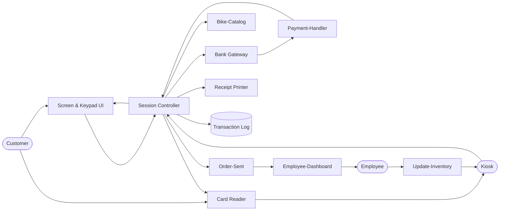
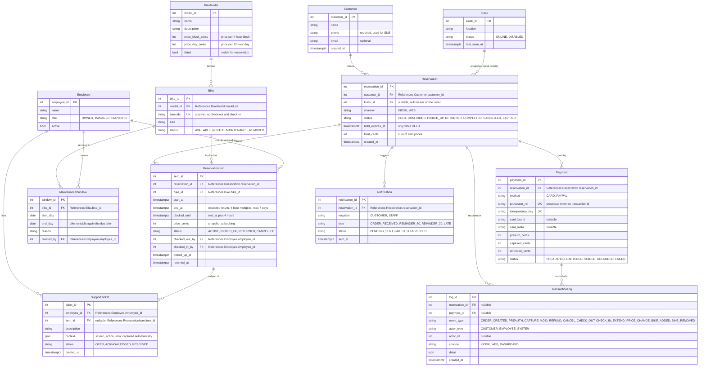
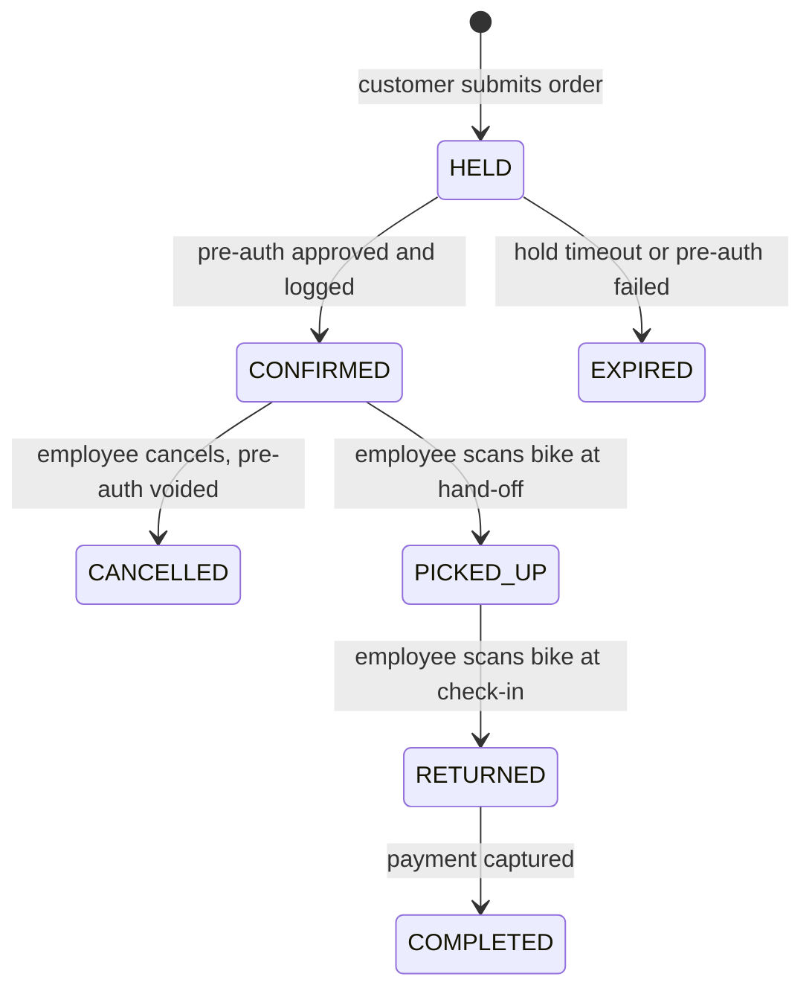
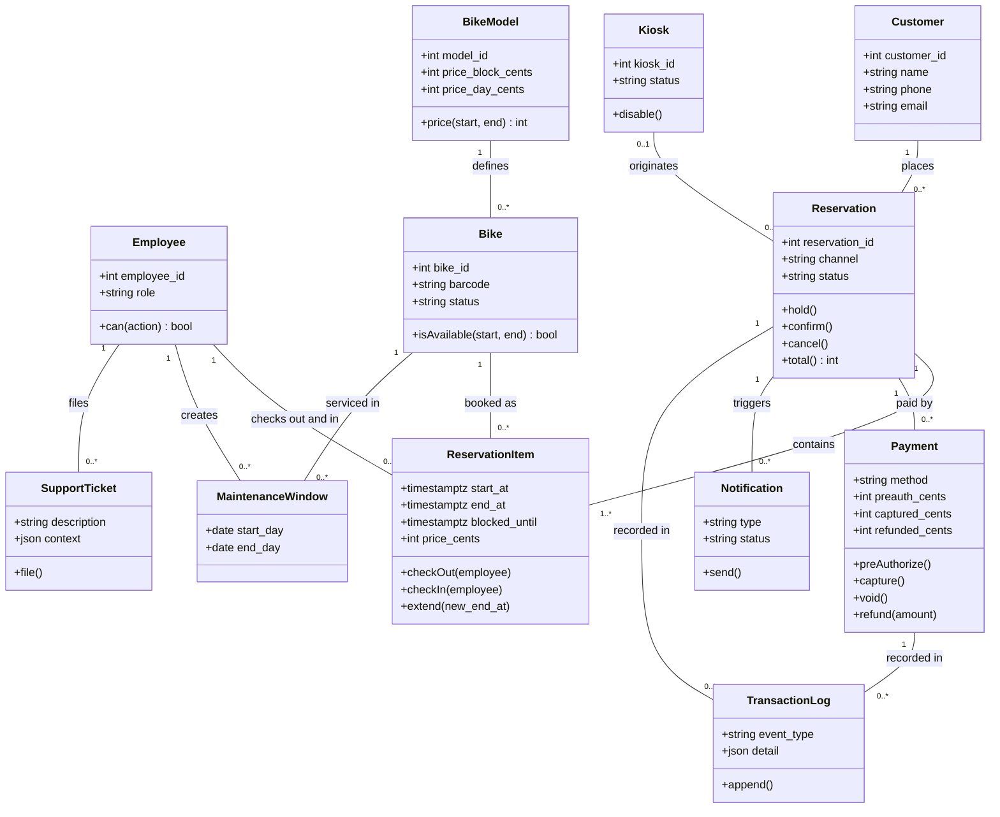

# Design Doc 


## Overview 
Rodney's Bike Shop system allows clients to reserve a bike(s) as well the client should be able to pay for it online. The staff should be able to list bikes for reservation, set prices, and put bikes into maintence as needed. 

## Actors 
* **Customer**: Place Order, Insert Payment, Take receipt 
* **Employee**: Check logs, Cancel-Orders, Update-Bookings, Excute Refunds, Remove Bikes, Add Bikes
* **Kiosk**: Take-Payment, Give-Change, Provide Receipt, Scroll, Add to Cart, Remove Bike
* **Online Website** Take-payment, provide receipt, scroll, add to cart, remove bike

## Goals/Non-Goals 

### Goals
* No account needed 
* Log all orders
* Alert staff automically 
* Print receipt 
* Charge correct prices  

### Non-Goals 
* No automatic discounts for now.
* Selling bikes is a diffrent system 
* No current inventory system, it's on paper
* No auto system for overbooking, from damage and late rental returns. 
* No auto system for stock limitatiosn 
* No system preventing rentals based on crazy weather clients could rent if they want  
* Replacement charge is human intervaention not auto
* Ad system handled by other team


## Constraints and Assumptions

### Constraints 
* There are 60 bikes, so about 60 rentals per day is the peak. This is not a high-concurrency system
* Rentals are capped at 7 days, in 4-hour intervals, and a day's fee equals 12 hours
* The card is pre-authorized at reservation and charged after return. Pre-authorization, charges, and refunds all use the processor's API. 
* Role base permissons for ownerm manager, employee
* All bike pickups, returns, extensions, size swaps, and damage assessments go through an employee during business hours. There is no self-service or after-hours pickup.

### Assumptions
* A bike out of service will be avaiable the next day, so let it be rented out for anyday after the day of service
* Most returned bikes are ready to be rented again after 4 hours, allow customers to book 4 hours after the expected return time.
* Card failure are caught 
* Everyone will use the dollar so no need for conversion rates/software/management 
* Abuse like mass no show reservations is low enough risk so don't design against it

## Non-Functional Requirements

| Requirement | Measure |
|---|---|
| Printed Receipt  | 100% of the time under 5 seconds |
| Order Sent  | Staff recieve order for bike from kiosk under 10 seconds |
| Payment Confirmation | 95% of the time payment confirmation is confirmed in under 9.99 seconds |
| System Restart | If system needs restart, system returns to normal state under 3 minutes |
| Wrong Payment Info | 0 Instances where wrong payment info is able to place a order |

## Component Diagram and Description



| Component | Responsibility |
|---|---|
|Receipt Printer  | Prints receipts  |
| Card Reader | Read card data |
| Kisosk | Terminal where customers can pick the bike and rent it for the day, as well pay |
| Session Controller | high level software ran on the kisok to provide information about the machine and the functionally needed from other componets |
| Bank Gateway | Connects the users information to the payment processor's API|
| Transaction Log| Contains logs all of transactions occuring on the terminal|
| Employee Dashboard | Pulls the order from session controller and lets employee see into the order|
| Screen & keypad UI | Allows customer to input pin and select the bike of their choosing|
| Update Inventory | Pulls from the employee dashboard and informs the kisok of any new changes made to the website or stock of bikes for rent|


## Data Model

**Conventions**
* Money is stored as integer cents (USD only). Times are stored in UTC and displayed in America/Los_Angeles.
* Customers are guests: a rental needs only `name`, `phone`, and payment. `email` is optional. There is no login or password.
* Prices are set per bike model. A reservation copies (snapshots) the price at booking time, so later price changes never alter existing bookings.
* Storage must be transactional and able to enforce a no-overlap rule per bike (e.g. a PostgreSQL range exclusion constraint, or an equivalent transactional check).
* Card numbers, CVV, and PINs are never stored. Only the processor's token/reference, card brand, and last 4 digits are kept.

### Entity Relationship Diagram


**Key constraints**
* `ReservationItem`: no two active items for the same `bike_id` may have overlapping `[start_at, blocked_until)` ranges. Enforced by the database, not only by application code.
* `ReservationItem`: `end_at - start_at` is a multiple of 4 hours and at most 7 days. `blocked_until = end_at + 4 hours`.
* `MaintenanceWindow`: a bike cannot be booked on any day from `start_day` through `end_day`. It is bookable again on the day after `end_day`.
* `Payment`: `captured_cents <= preauth_cents` and `refunded_cents <= captured_cents`.
* `TransactionLog`: append-only. Unique on (`payment_id`, `event_type`) where `event_type = CAPTURE`.
* `Notification`: unique on (`reservation_id`, `recipient`, `type`) so a reminder is never sent twice.

**Price rule** (applies to the booked duration, and again to the actual return time if later than `end_at`)
```
blocks = ceil(duration / 4h)
days   = blocks // 3                       # 3 blocks = 12 hours = one day's fee
price  = days * price_day_cents + min((blocks % 3) * price_block_cents, price_day_cents)
```

### Reservation Lifecycle

`HELD` reserves the bike while the customer pays. The default hold is 10 minutes (configurable). A bike is only handed out from `CONFIRMED`.

### Class Diagram



## Interfaces

**Conventions**
* Every call returns `Ok(value)` or `Err(code)`. Shared error codes: `INVALID_INPUT`, `NOT_FOUND`, `FORBIDDEN`, `UNAVAILABLE` (bike conflict), `PAYMENT_DECLINED`, `GATEWAY_DOWN`, `TIMEOUT`.
* Every state-changing call takes an `idempotency_key`. Repeating a call with the same key returns the original result and does not repeat the side effect.
* Roles are cumulative: Owner includes Manager, and Manager includes Employee. `Customer` and `System` are separate callers.
* Online orders never touch raw card data. The website uses the processor's hosted card fields or PayPal. Only the kiosk reader handles card data, and only to pass it to the processor.

``` python
printReceipt(transactionID: TransID, Customer_name: Name) -> printed
```

| Row | Meaning |
|---|---|
| **Purpose** | Prints the receipt  |
| **Requires** | A valid transaction ID, a customer name, and a `CONFIRMED` reservation |
| **Outcomes** | Approved : Prints the receipt with bikes, dates, price, and last 4 digits of the card Declined : No ID or No Name does not print. Printer error : retry once, then flag staff |
| **Guarantees** | Prints within 5 seconds (NFR). The transaction ID is valid if it prints. A failed print never changes the order. A receipt can be reprinted from the Transaction Log |
| **Notes** | This is not required if the client does not want the receipt. Caller: Customer (kiosk) or Employee (reprint) |

``` python
logTransaction(transactionID: TransID, Customer_name: Name, event_type: Event, detail: Json) -> Transaction_Log_DB
```

| Row | Meaning |
|---|---|
| **Purpose** | Appends an event to the transaction log and sends the order to the staff dashboard |
| **Requires** | Transaction confirmed flag must be set for the account/transaction (for `PREAUTH`/`CAPTURE` events) |
| **Outcomes** | Approved : The event is logged and, for a new order, sent to staff Declined : Invaild information try again |
| **Guarantees** | A temp log is put in place in the databse and updated with the correct information if the log works. The log is append-only. Staff see a new kiosk order within 10 seconds (NFR). A capture has exactly one log entry |
| **Notes** | If the call to log can't log within 1 minute staff is flagged. Caller: System |

``` python
cardReader(transactionID: TransID, card: Card, pin: Pin, Customer_name: Name) -> sentToBankGateway
```

| Row | Meaning |
|---|---|
| **Purpose** | Reads the card at the kiosk and passes it to the Bank Gateway for pre-authorization |
| **Requires** | The machine needs to have a vaild transcation ID before payment, and the reservation must be `HELD` |
| **Outcomes** | Approved : The pre-authorization succeeds and payment is confirmed Declined : Invaild information try again  OR Payment failed try again? Unreadable/Unsupported : card ejected, no transaction created |
| **Guarantees** | Pin is not saved. Card data is not stored. Wrong payment info never results in a confirmed order (0 instances, NFR) |
| **Notes** | Pin not saved, information about the card wiped as soon as possible. The customer gets up to 3 attempts per hold. Caller: Customer (kiosk only) |

``` python
bikeQuery(transactionID: TransID, Customer_name: Name, bikeModels: Model, price: Price,
          start_at: Time, end_at: Time) -> Requested Bike Page
```

| Row | Meaning |
|---|---|
| **Purpose** | Searches the list for a bike model and shows the bikes free for the requested window |
| **Requires** | Bike catalog must be up to date. `start_at`/`end_at` are in 4-hour steps and at most 7 days apart |
| **Outcomes** |Approved : The page shows the requested model, with bikes free for the window and the price Declined : Retry the search once ? Empty result : "none available" with the nearest open times |
| **Guarantees** | The bike catalog is up to date before the search calls. A bike is listed only if it has no overlapping reservation (including the 4-hour buffer), is not in maintenance, and is not removed |
| **Notes** | Calls update bike catalog and auto retries once. Caller: Customer (kiosk or web) |

``` python
createReservation(customer: {name, phone, email?}, items: [{bike_id, start_at, end_at}],
                  channel: Channel, kiosk_id: Id?, idempotency_key: Key) -> reservation_id
```

| Row | Meaning |
|---|---|
| **Purpose** | Creates a `HELD` reservation for one or more bikes. No account is created |
| **Requires** | Name and phone. Every item is valid per `bikeQuery` rules. Max 7 days per item |
| **Outcomes** | Approved : `HELD` reservation with `hold_expires_at` and server-calculated total Declined : `UNAVAILABLE` (names the conflicting bike) or `INVALID_INPUT` |
| **Guarantees** | Atomic: all items are held or none are. Price is the snapshot from the Price rule. Double booking is blocked by the database constraint even if kiosk and web race |
| **Notes** | Caller: Customer |

``` python
preAuthorize(reservation_id: Id, method: Method, payment_token: Token, idempotency_key: Key) -> Payment
```

| Row | Meaning |
|---|---|
| **Purpose** | Places a hold on the customer's card (or approves PayPal) for the reservation total via the Bank Gateway |
| **Requires** | Reservation is `HELD` and not expired. Token comes from the kiosk reader, processor hosted fields, or PayPal |
| **Outcomes** | Approved : Payment `PREAUTHED`, reservation `CONFIRMED`, event logged, staff alerted Declined : `PAYMENT_DECLINED`, reservation stays `HELD` until expiry. `GATEWAY_DOWN` after retries (see Failure Modes) |
| **Guarantees** | Never confirms without an approved pre-auth. The same idempotency key never creates a second hold. Gateway timeouts are reconciled with the processor before reporting a result |
| **Notes** | Meets 95% of confirmations under 9.99 seconds (NFR). Caller: Customer / System |

``` python
capturePayment(reservation_id: Id, idempotency_key: Key) -> Payment
refundPayment(payment_id: Id, amount_cents: int, reason: str, employee_id: Id, idempotency_key: Key) -> Payment
```

| Row | Meaning |
|---|---|
| **Purpose** | Capture charges the card after return. Refund returns money (full, partial, or void of an uncaptured pre-auth on cancel) |
| **Requires** | Capture: reservation is `RETURNED`. Refund: Employee role, `amount_cents <= captured_cents - refunded_cents`, a reason |
| **Outcomes** | Approved : `CAPTURED` / `REFUNDED` / `VOIDED`, logged, reservation `COMPLETED` after capture Declined : `PAYMENT_DECLINED`, reservation stays `RETURNED` and staff is flagged for manual follow-up |
| **Guarantees** | Capture amount is the Price rule applied to the booked end or actual return, whichever is later. An amount above the pre-auth needs a new authorization or staff follow-up. Replacement and damage charges are never automatic (non-goal) |
| **Notes** | Caller: System (capture), Employee (refund) |

``` python
checkOutBike(barcode: Barcode, reservation_id: Id, employee_id: Id) -> ReservationItem
checkInBike(barcode: Barcode, employee_id: Id) -> ReservationItem
```

| Row | Meaning |
|---|---|
| **Purpose** | Records hand-off to the customer and return of the bike. Both are scanned by an employee |
| **Requires** | Check-out: reservation `CONFIRMED`, scanned bike matches an item, business hours. Check-in: bike is currently `PICKED_UP` |
| **Outcomes** | Approved : Item and reservation status updated, event logged, bike status updated, pending reminders suppressed on check-in Declined : `NOT_FOUND` (barcode not in an open reservation) or `FORBIDDEN` |
| **Guarantees** | The write is committed and re-read before the UI shows success, so a green check always means the state is saved. Check-in cancels any unsent reminders for that reservation. A bike is never handed out unless the transaction is confirmed |
| **Notes** | If the commit cannot be verified, the UI shows an error and an auto-filled support ticket is offered. Caller: Employee |

``` python
listEndingSoon(within_minutes: int) -> [ {item, customer_phone, next_reservation_start_at?} ]
extendRental(item_id: Id, new_end_at: Time, employee_id: Id, idempotency_key: Key) -> ReservationItem
```

| Row | Meaning |
|---|---|
| **Purpose** | Lets staff find bikes about to be late, see whether another booking follows, and lengthen the rental |
| **Requires** | `new_end_at` is later than `end_at`, in 4-hour steps, total stays within 7 days. No other reservation or maintenance overlaps the new `blocked_until` |
| **Outcomes** | Approved : `end_at`, `blocked_until`, and price updated, pre-auth increased by the difference, event logged Declined : `UNAVAILABLE` (next booking exists) or `PAYMENT_DECLINED` (original rental unchanged) |
| **Guarantees** | Atomic: the booking is extended only if the extra pre-auth succeeds. Sorted by soonest `end_at`. The 1-hour and 30-minute texts use the new `end_at` after an extension |
| **Notes** | Caller: Employee |

``` python
setMaintenance(bike_id: Id, start_day: Date, end_day: Date, reason: str, employee_id: Id) -> MaintenanceWindow
updateCatalog(action: Add | Remove | SetPrice | List | Unlist, payload: Json, employee_id: Id) -> Bike | BikeModel
```

| Row | Meaning |
|---|---|
| **Purpose** | Puts bikes into maintenance, and lets staff add/remove bikes and set prices |
| **Requires** | Maintenance, Add, Remove: Employee role. SetPrice: Manager role. A bike with future reservations cannot be removed silently |
| **Outcomes** | Approved : Change saved, logged, kiosk and website catalog refreshed Declined : `FORBIDDEN`, or `UNAVAILABLE` with the list of conflicting reservations |
| **Guarantees** | Existing reservations keep their snapshot price. Maintenance never cancels bookings by itself; staff must resolve the listed conflicts (no auto overbooking handling, non-goal). Kiosk catalog is updated within one refresh cycle (Update Inventory) |
| **Notes** | Caller: Employee / Manager |

``` python
sendNotification(reservation_id: Id, type: ORDER_RECEIVED | REMINDER_60 | REMINDER_30 | LATE) -> Notification
reportIssue(employee_id: Id, description: str, item_id: Id?, context: Json) -> SupportTicket
```

| Row | Meaning |
|---|---|
| **Purpose** | Sends SMS to customers and alerts to staff, and lets staff report system problems to the developer team |
| **Requires** | Notification: reservation not yet `RETURNED` for reminders, valid phone. Ticket: any signed-in employee |
| **Outcomes** | Approved : Notification `SENT`, or ticket created and the developer team notified immediately Declined : `FAILED` notification is retried up to 3 times, then staff flagged |
| **Guarantees** | Each reminder type is sent at most once per reservation and never after check-in. Ticket captures screen, action, and error automatically. Notification failure never blocks a rental |
| **Notes** | Caller: System (notifications), Employee (tickets) |


## Invariants 
- Bike is only given when the transaction is confirmed (reservation `CONFIRMED`, payment `PREAUTHED`)
- No bike has two overlapping active reservations. The 4-hour return buffer counts as part of the reservation.
- Every captured payment has exactly one `CAPTURE` entry in the transaction log, and the log is never edited or deleted.
- Customers pins are secured and always wiped. Card numbers, CVV, and PINs are never stored or logged.
- A bike in maintenance cannot be reserved for that window. It is bookable again the day after the service ends.
- A guest can complete a rental with only name, phone, and payment. No step requires an account.
- Rentals are in 4-hour steps, at most 7 days, and every price comes from the Price rule using the price snapshot taken at booking.
- Pre-authorization is never larger than the reservation total. `captured <= preauth` and `refunded <= captured` for every payment.
- A reservation is `CONFIRMED` only after an approved pre-auth and a logged order. No other path confirms an order.
- A check-in or check-out is reported as successful only after it is saved and verified.
- A reminder text is sent at most once per type and never for a bike that has been checked in.
- Every refund, cancel, extension, maintenance, price, and bike add/remove action records the employee who did it. Permissions follow the role (Owner, Manager, Employee).
- Repeating any state-changing call with the same idempotency key never repeats its side effect.


## Failure Modes

| # | Failure | Detection | Response | Customer Sees |
|---|---|---|---|---|
| 1 | Card unreadable or unsupported | `awaitCard` returns **Unreadable** or **Unsupported** | Eject card. No transaction is created. | Card could not be read |
| 2 |  Third Party Gateway  | Failure to connect to thirdparty gateway API | Retry once in 5 seconds then in another 30 seconds if the retry fails. If still down, keep the hold until it expires, alert staff, and create no payment record | Third Party Gateway down Please report to front desk | 
| 3 | Wifi Loss | Wifi-status returns false | Wait 45 seconds for wifi to try and reconnected alert staff. If it does not return, cancel the session, release the hold, and void any pre-auth already sent (confirm with processor when back online) | Wifi lost transcation canceled staff is coming! |
| 4 | Kisosk drive fails| Unscheduled restarts/data differs from earlier scan | Disables the kisok. Eject card if one is in the reader. On restart, reconcile every `HELD` order against the processor: confirm if pre-authed, otherwise expire. Return to normal within 3 minutes | If card in unlock card. Kiosk out of service, please see front desk |
| 5 | Pre-auth declined or wrong payment info | Processor returns decline or mismatch (CVV, ZIP) | Reservation stays `HELD`. Allow up to 3 attempts, then expire the hold. Never confirm | Card declined, try again or use another payment method |
| 6 | Double booking race (kiosk and website pick the same bike) | Database overlap constraint rejects the second `createReservation` | Reject the later order, release its other held items (all-or-nothing), show alternatives | That bike was just taken. Pick another bike or time |
| 7 | Pre-auth response lost or timed out | No gateway reply within the timeout, or duplicate callback | Look up the payment by `idempotency_key` at the processor before retrying. Confirm if approved, void if unknown after 60 seconds. Never create a second hold | Still processing, please wait. If it fails: payment not completed, you were not charged |
| 8 | Transaction log write fails | `logTransaction` errors or exceeds 1 minute | Keep the temp log, retry, then flag staff. Do not give a bike until the order is logged | Order is being confirmed, please see front desk if this takes long |
| 9 | Staff alert not delivered | No dashboard acknowledgement within 10 seconds | Retry delivery. Dashboard also polls open `CONFIRMED` orders as a fallback and highlights unseen ones | Order received (receipt still prints) |
| 10 | Receipt printer fails (jam, no paper) | Printer status error or no print confirmation within 5 seconds | Retry once. The order is not affected. Flag staff. Receipt can be reprinted from the log | Receipt could not print. Your rental is confirmed, ask staff for a copy |
| 11 | Check-in not saved (green check but still not checked in) | Read-back after write does not match, or write errors | Show an error instead of a success check, keep reminders running, offer a one-click support ticket with the screen and error attached, notify the developer team immediately | (Employee) Check-in failed, ticket sent to developers |
| 12 | Tech support form unreachable | Ticket submit fails or employee site is down | Dashboard shows a fallback developer contact. Use the paper log (inventory is already on paper) until restored. Tickets queue and send when back | (Employee) Contact developers at the number shown |
| 13 | Capture fails after return (expired card, insufficient funds) | Processor declines on `capturePayment` | Reservation stays `RETURNED` (not `COMPLETED`). Flag staff for manual follow-up. No automatic retries beyond 3 | Contacted by staff about payment |
| 14 | Extension cannot be done | Next reservation or maintenance overlaps, or extra pre-auth declined | Reject the extension and leave the original booking unchanged. Show the next booking time to staff | (Employee) Bike is booked from 3:00 PM, cannot extend |
| 15 | Maintenance scheduled over existing reservations | `setMaintenance` finds overlapping items | Block the change and list the conflicts. Staff reassign or cancel them manually. No auto overbooking handling | (Employee) 2 reservations conflict, resolve first |
| 16 | SMS fails or reminder duplicated | Provider error, or reminder already `SENT` / bike already checked in | Retry up to 3 times then mark `FAILED` and flag staff. Duplicates are blocked by the unique key. Reminders suppressed after check-in | Nothing, or a late text is avoided |
| 17 | Employee lacks permission | Role check fails (e.g. Employee tries to set prices) | Reject with `FORBIDDEN` and log the attempt | (Employee) You do not have permission for this action |
