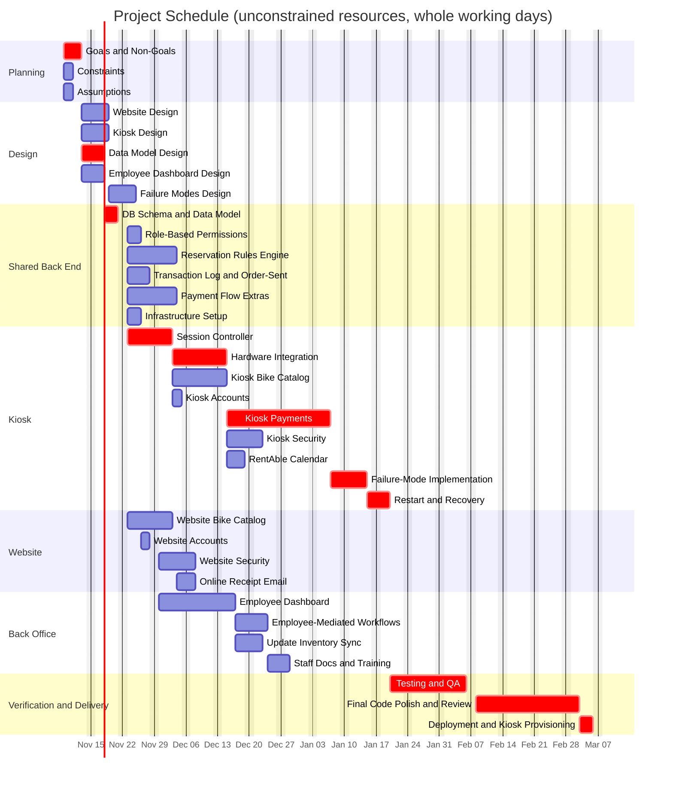

# Estimation
 
## Work Breakdown Structure

- Rodney Bike Shop (100%)
    - Design (13.5%)
        - Requirement Gathering (4.1%)
            - Goals/Non Goals (2.1%)
            - Constraints (1.0%)
            - Assumptions (1.0%)
        - Website Design (2.1%)
        - Kiosk Design (2.1%)
        - Data Model Design (1.5%)
        - Employee Dashboard Design (1.5%)
        - Failure Modes Design (2.1%)
    - Coding (66.6%)
        - Website (9.1%)
            - Bike Catalog (4.1%)
            - Accounts (1.0%)
            - Security (3.0%)
            - Online Receipt / Email (1.0%)
        - Kiosk (31.7%)
            - Session Controller (4.2%)
            - Hardware Integration: card reader, receipt printer (3.9%)
            - Bike Catalog (4.1%)
            - Accounts (1.0%)
            - Payments (8.6%)
            - Security (3.0%)
            - RentAble Calendar (2.1%)
            - Failure-Mode Implementation (3.2%)
            - Restart and Recovery (1.6%)
        - Shared / Back Office (25.7%)
            - DB Schema and Data Model (1.6%)
            - Role-Based Permissions (1.6%)
            - Reservation Rules Engine (4.3%)
            - Transaction Log and Order-Sent Notification (2.6%)
            - Payment Flow: pre-auth, capture, refund, Bank Gateway (4.4%)
            - Employee Dashboard (6.4%)
            - Employee-Mediated Workflows (2.7%)
            - Update Inventory Sync (2.1%)
    - Verification and Delivery (19.9%)
        - Testing and QA incl. NFR verification (6.4%)
        - Infrastructure Setup (1.5%)
        - Staff Docs and Training (1.5%)
        - Final Code Polish and Review (8.8%)
        - Deployment and Kiosk Provisioning (1.7%)
## PERT Times
 
Expected = (O + 4M + P) / 6. Days.
 
| ID | Task | O | M | P | Expected |
| :--- | :--- | :---: | :---: | :---: | :---: |
| 0 | Goals/Non-Goals | 2.92 | 3.85 | 6.67 | 4.17 |
| 1 | Constraints | 1.40 | 1.85 | 3.20 | 2.00 |
| 2 | Assumptions | 1.40 | 1.85 | 3.20 | 2.00 |
| 3 | Website Design | 2.92 | 3.85 | 6.67 | 4.17 |
| 4 | Kiosk Design | 2.92 | 3.85 | 6.67 | 4.17 |
| 5 | Data Model Design | 2.10 | 2.78 | 4.80 | 3.00 |
| 6 | Employee Dashboard Design | 2.10 | 2.78 | 4.80 | 3.00 |
| 7 | Failure Modes Design | 2.92 | 3.85 | 6.67 | 4.17 |
| 8 | DB Schema and Data Model | 2 | 3 | 5 | 3.17 |
| 9 | Role-Based Permissions | 2 | 3 | 5 | 3.17 |
| 10 | Reservation Rules Engine | 5 | 8 | 14 | 8.50 |
| 11 | Transaction Log and Order-Sent | 3 | 5 | 8 | 5.17 |
| 12 | Payment Flow: Pre-auth/Capture/Refund | 5 | 8 | 15 | 8.67 |
| 13 | Kiosk: Session Controller | 5 | 8 | 13 | 8.33 |
| 14 | Kiosk: Hardware Integration | 4 | 7 | 14 | 7.67 |
| 15 | Website: Bike Catalog | 5.60 | 7.40 | 12.80 | 8.00 |
| 16 | Website: Accounts | 1.40 | 1.85 | 3.20 | 2.00 |
| 17 | Website: Security | 4.20 | 5.55 | 9.60 | 6.00 |
| 18 | Website: Online Receipt | 1 | 2 | 3 | 2.00 |
| 19 | Employee Dashboard | 8 | 12 | 20 | 12.67 |
| 20 | Employee-Mediated Workflows | 3 | 5 | 9 | 5.33 |
| 21 | Kiosk: Bike Catalog | 5.60 | 7.40 | 12.80 | 8.00 |
| 22 | Kiosk: Accounts | 1.40 | 1.85 | 3.20 | 2.00 |
| 23 | Update Inventory Sync | 2 | 4 | 7 | 4.17 |
| 24 | Kiosk: Payments | 11.90 | 15.73 | 27.20 | 17.00 |
| 25 | Kiosk: Security | 4.20 | 5.55 | 9.60 | 6.00 |
| 26 | Kiosk: RentAble Calendar | 2.92 | 3.85 | 6.67 | 4.17 |
| 27 | Failure-Mode Implementation | 4 | 6 | 10 | 6.33 |
| 28 | Restart and Recovery | 2 | 3 | 5 | 3.17 |
| 29 | Testing and QA | 8 | 12 | 20 | 12.67 |
| 30 | Staff Docs and Training | 2 | 3 | 4 | 3.00 |
| 31 | Infrastructure Setup | 2.10 | 2.78 | 4.80 | 3.00 |
| 32 | Final Code Polish and Review | 12.13 | 16.03 | 27.73 | 17.33 |
| 33 | Deployment and Kiosk Provisioning | 2.33 | 3.08 | 5.33 | 3.33 |
 
Total effort (sum of expected durations): ~197.5 person-days.
 
## Monte Carlo Results
 
| Percentile | Working days | Finish date (from Mon 2026-11-09) |
| :--- | :---: | :---: |
| P50 | 86.0 | Mon 2027-03-08 |
| P80 | 90.6 | Mon 2027-03-15 |
| **P90** | **93.1** | **Thu 2027-03-18** |
| P95 | 95.2 | Fri 2027-03-19 |
 
 
 
## Schedule (CPM)
 
| Task ID | Task Description | Dependencies | Duration | ES | EF | LS | LF | Slack | Critical Path? |
| :--- | :--- | :--- | :---: | :---: | :---: | :---: | :---: | :---: | :---: |
| **0** | Goals/Non-Goals | — | 4.17 | 0.00 | 4.17 | 0.00 | 4.17 | 0.00 | **Yes** |
| **1** | Constraints | — | 2.00 | 0.00 | 2.00 | 2.17 | 4.17 | 2.17 | No |
| **2** | Assumptions | — | 2.00 | 0.00 | 2.00 | 2.17 | 4.17 | 2.17 | No |
| **3** | Website Design | [0, 1, 2] | 4.17 | 4.17 | 8.34 | 28.50 | 32.67 | 24.33 | No |
| **4** | Kiosk Design | [0, 1, 2] | 4.17 | 4.17 | 8.34 | 6.17 | 10.34 | 2.00 | No |
| **5** | Data Model Design | [0, 1, 2] | 3.00 | 4.17 | 7.17 | 4.17 | 7.17 | 0.00 | **Yes** |
| **6** | Employee Dashboard Design | [0, 1, 2] | 3.00 | 4.17 | 7.17 | 31.84 | 34.84 | 27.67 | No |
| **7** | Failure Modes Design | [4] | 4.17 | 8.34 | 12.51 | 39.17 | 43.34 | 30.83 | No |
| **8** | DB Schema and Data Model | [5] | 3.17 | 7.17 | 10.34 | 7.17 | 10.34 | 0.00 | **Yes** |
| **9** | Role-Based Permissions | [8] | 3.17 | 10.34 | 13.51 | 31.67 | 34.84 | 21.33 | No |
| **10** | Reservation Rules Engine | [8] | 8.50 | 10.34 | 18.84 | 39.01 | 47.51 | 28.67 | No |
| **11** | Transaction Log and Order-Sent | [8] | 5.17 | 10.34 | 15.51 | 29.67 | 34.84 | 19.33 | No |
| **12** | Payment Flow: Pre-auth/Capture/Refund | [8] | 8.67 | 10.34 | 19.01 | 17.67 | 26.34 | 7.33 | No |
| **13** | Kiosk: Session Controller | [4, 8] | 8.33 | 10.34 | 18.67 | 10.34 | 18.67 | 0.00 | **Yes** |
| **14** | Kiosk: Hardware Integration | [13] | 7.67 | 18.67 | 26.34 | 18.67 | 26.34 | 0.00 | **Yes** |
| **15** | Website: Bike Catalog | [3, 8] | 8.00 | 10.34 | 18.34 | 32.67 | 40.67 | 22.33 | No |
| **16** | Website: Accounts | [9] | 2.00 | 13.51 | 15.51 | 44.84 | 46.84 | 31.33 | No |
| **17** | Website: Security | [16] | 6.00 | 15.51 | 21.51 | 46.84 | 52.84 | 31.33 | No |
| **18** | Website: Online Receipt | [12, 15] | 2.00 | 19.01 | 21.01 | 50.84 | 52.84 | 31.83 | No |
| **19** | Employee Dashboard | [6, 9, 11] | 12.67 | 15.51 | 28.18 | 34.84 | 47.51 | 19.33 | No |
| **20** | Employee-Mediated Workflows | [10, 19] | 5.33 | 28.18 | 33.51 | 47.51 | 52.84 | 19.33 | No |
| **21** | Kiosk: Bike Catalog | [13, 15] | 8.00 | 18.67 | 26.67 | 40.67 | 48.67 | 22.00 | No |
| **22** | Kiosk: Accounts | [9, 13] | 2.00 | 18.67 | 20.67 | 44.84 | 46.84 | 26.17 | No |
| **23** | Update Inventory Sync | [19, 21] | 4.17 | 28.18 | 32.35 | 48.67 | 52.84 | 20.49 | No |
| **24** | Kiosk: Payments | [12, 14] | 17.00 | 26.34 | 43.34 | 26.34 | 43.34 | 0.00 | **Yes** |
| **25** | Kiosk: Security | [14, 22] | 6.00 | 26.34 | 32.34 | 46.84 | 52.84 | 20.50 | No |
| **26** | Kiosk: RentAble Calendar | [10, 21] | 4.17 | 26.67 | 30.84 | 48.67 | 52.84 | 22.00 | No |
| **27** | Failure-Mode Implementation | [7, 24] | 6.33 | 43.34 | 49.67 | 43.34 | 49.67 | 0.00 | **Yes** |
| **28** | Restart and Recovery | [27] | 3.17 | 49.67 | 52.84 | 49.67 | 52.84 | 0.00 | **Yes** |
| **29** | Testing and QA | [17, 18, 20, 23, 25, 26, 28] | 12.67 | 52.84 | 65.51 | 52.84 | 65.51 | 0.00 | **Yes** |
| **30** | Staff Docs and Training | [20] | 3.00 | 33.51 | 36.51 | 79.84 | 82.84 | 46.33 | No |
| **31** | Infrastructure Setup | [8] | 3.00 | 10.34 | 13.34 | 79.84 | 82.84 | 69.50 | No |
| **32** | Final Code Polish and Review | [29] | 17.33 | 65.51 | 82.84 | 65.51 | 82.84 | 0.00 | **Yes** |
| **33** | Deployment and Kiosk Provisioning | [30, 31, 32] | 3.33 | 82.84 | 86.17 | 82.84 | 86.17 | 0.00 | **Yes** |
 
Critical path: 0 → 5 → 8 → 13 → 14 → 24 → 27 → 28 → 29 → 32 → 33 (86.17 days).
 

 